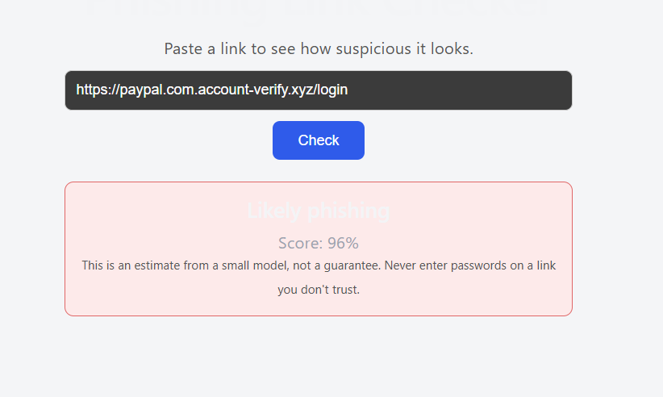
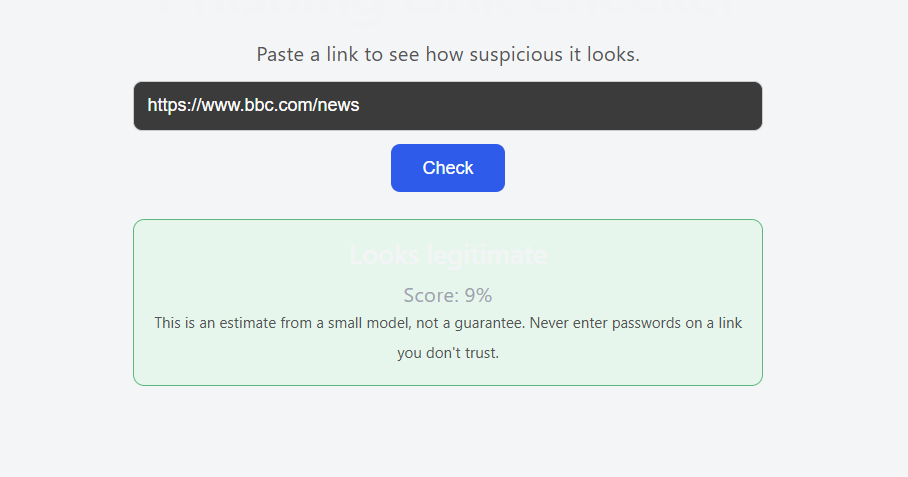

# Phishing Link Checker

A web app that scores how likely a URL is to be phishing, using a character-level
neural network (TensorFlow/Keras), a FastAPI backend and a React frontend.

## Demo

| Phishing link                                | Legitimate link                             |
| -------------------------------------------- | ------------------------------------------- |
|  |  |

## How it works

1. The link is cleaned (lowercase, no scheme, no `www.`, no trailing slash).
2. Each character is encoded as a number and fed to a 1D convolutional network.
3. The API returns a probability and a label using a 0.4 threshold.

## Stack

Python, Pandas, scikit-learn, TensorFlow/Keras, FastAPI, React (Vite), Google Colab.

## Results

Dataset: Kaggle "Malicious URLs dataset" (benign + phishing only, duplicates removed).

| Model                                   | Precision | Recall   |
| --------------------------------------- | --------- | -------- |
| Hand-made features + Random Forest      | 0.48      | 0.74     |
| Character TF-IDF + linear model         | 0.67      | 0.69     |
| **Keras character CNN (threshold 0.4)** | **0.74**  | **0.73** |

## What I learned (and the problems I found)

- My first dataset (UCI) scored 94%, but its features needed the live website, so
  it could not work on a plain link.
- A second dataset scored 99.5%, but the model had learned shortcuts (every legit
  link was HTTPS with no path). Testing on real-looking links exposed this.
- Hand-written "trusted domain" lists failed because scammers host phishing on
  trusted platforms such as Google Docs and Google Sites.
- The dataset has contradictory labels (the same kind of link appears as both
  legitimate and phishing), which limits the achievable score.

## Limitations

- Training data is old and the model can be wrong, e.g. `github.com/login`
  is flagged as phishing.
- It reads only the link text, not the page content.
- Not a security product. Do not rely on it alone.

## Run it

Backend (Python 3.12):
cd backend
py -3.12 -m venv venv
venv\Scripts\activate
pip install tensorflow fastapi uvicorn numpy
uvicorn main:app --reload

Frontend:
cd frontend
npm install
npm run dev

## Notebooks

- `notebooks/01_uci_baseline.ipynb`: first attempt
- `notebooks/02_url_char_model.ipynb`: final model

## Next steps

Better data (Tranco top sites for legitimate links, OpenPhish for fresh phishing
links, after checking their terms), and features from page content.
